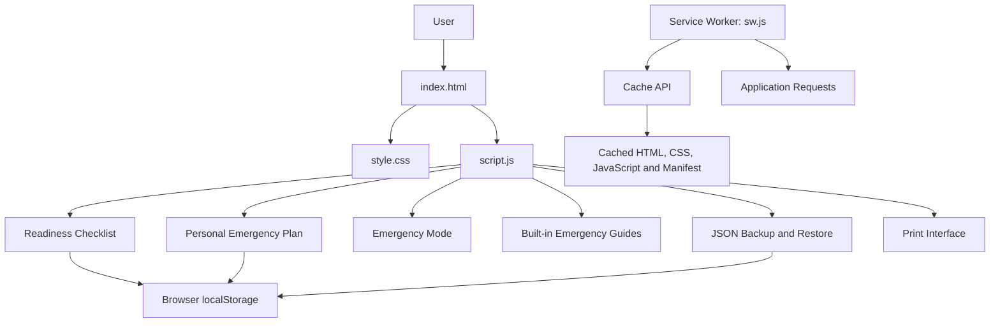

# NIRANTAR - Offline-First Emergency Preparedness

> **When connectivity fails, preparedness shouldn't.**

NIRANTAR is an offline-first emergency preparedness web application designed to help individuals and households organize essential emergency information, track readiness tasks, and access built-in safety guides when internet connectivity is unavailable.

Built using HTML, CSS, and JavaScript, NIRANTAR combines an emergency readiness checklist, a personal emergency plan, quick-access Emergency Mode, searchable safety guides, and backup tools in one responsive interface.

The application uses browser local storage and service worker caching to support access to previously saved information and cached application resources offline.

---

## 📌 Table of Contents

- [The Problem](#-the-problem)
- [Our Solution](#-our-solution)
- [Key Features](#-key-features)
- [Technology Stack](#️-technology-stack)
- [Project Structure](#-project-structure)
- [Getting Started](#️-getting-started)
- [How to Use NIRANTAR](#-how-to-use-nirantar)
- [Application Architecture](#-application-architecture)
- [Data Storage and Backup](#-data-storage-and-backup)
- [Privacy and Security](#-privacy-and-security)
- [Testing](#-testing)
- [Target Audience and Impact](#-target-audience-and-impact)
- [Limitations and Future Scope](#-limitations-and-future-scope)
- [Safety Disclaimer](#️-safety-disclaimer)
- [License](#-license)

## 🚨 The Problem

Emergencies such as fires, floods, severe weather, and power outages can disrupt internet connectivity and access to digital services.

At these moments, people may need emergency contacts, safety instructions, and preparedness information quickly. When this information is spread across different places, finding it can become difficult under pressure.

**The challenge:** How can people keep essential preparedness information organized and accessible even when the internet is unavailable?

## 💡 Our Solution

NIRANTAR brings everyday emergency preparedness tools together in one browser-based application.

It helps users track essential readiness tasks, save important contact details, document household supplies and instructions, and consult built-in safety guides.

By storing personal data locally and caching application resources, NIRANTAR is designed to remain useful during connectivity interruptions after its initial setup and successful caching.

## ✨ Key Features

### ✅ 1. Emergency Readiness Checklist

Stay organized before an emergency occurs.

- Track six preparedness tasks covering drinking water, first-aid supplies, emergency contacts, essential documents, backup lighting and power, and household planning.
- Mark individual tasks as completed.
- View completion percentage and remaining tasks.
- Save checklist progress in browser local storage.

### 📝 2. Personal Emergency Plan

Keep important information organized in one place.

- Save an emergency contact's name, relationship, and phone number.
- Select prepared supplies, including water, a first-aid kit, a flashlight, a power bank, essential documents, and necessary medicines.
- Record important instructions or meeting arrangements.
- Save the plan on the current device for later access.

### 🚨 3. Emergency Mode

Access previously saved information through a dedicated emergency view.

- Display the saved emergency contact and relationship.
- Provide a phone link when a usable contact number is available.
- Show selected supplies and saved instructions.
- Reduce the need to search through multiple sections for important information.

Emergency Mode displays information saved by the user. It does not automatically call emergency services, transmit a location, or send alerts.

### 📚 4. Searchable Offline Emergency Guides

Access built-in guidance for five topics:

| Guide | Purpose |
|---|---|
| 🔥 Fire and evacuation | Basic fire safety and evacuation guidance |
| 🔦 Power outage | Safer practices during electricity disruptions |
| 🌧️ Severe weather and flooding | Preparation and basic safety guidance for severe weather and rising water |
| 🩹 First-aid basics | Initial steps while arranging appropriate medical help |
| 📞 Contacting emergency services | Information to communicate when seeking emergency assistance |

Search guide titles, categories, summaries, and instructions to find relevant content.

The guide content is included in the application's JavaScript, allowing it to be accessed offline when the application resources have been cached successfully.

### 💾 5. JSON Backup and Restore

Protect your preparedness information with portable backups.

- Export checklist and personal plan data as a JSON file.
- Import supported version 1 and version 2 backup formats.
- Validate the backup structure, checklist tasks, and version 2 personal plan fields before changing saved data.
- Ask for confirmation before restoring and replacing saved information.
- Attempt to recover previous saved values if a storage operation fails.

**Backup formats:**
- **Version 1:** Checklist data.
- **Version 2:** Checklist data and personal plan information. The plan can be `null` when no plan was saved at export time.

Version 1 restores preserve the existing personal plan. Version 2 restores update the plan as represented in the backup, including removing the stored plan when its value is `null`.

Imported backup files are limited to 1 MB.

### 🖨️ 6. Printable Emergency Plan

- Open the browser's print interface for your emergency plan.
- Print a physical copy or save it as a PDF using the browser's available print options.
- Keep a copy available when digital access is inconvenient.

### 📶 7. Offline-First Application Access

- Register a service worker to manage offline requests.
- Cache essential application files using the Cache API.
- Serve cached application resources when the network is unavailable.
- Keep checklist and personal plan data in browser local storage.

**Important:** Open NIRANTAR online through a local server or HTTPS and allow caching to complete before testing or relying on offline access.

### 📱 8. Responsive and Accessible Interface

- Responsive layout for different screen sizes.
- Keyboard-reachable controls.
- Touch-friendly interactions.
- Readable text and contrast.
- Straightforward navigation between the main application sections.

---

## 🛠️ Technology Stack

| Technology | Purpose |
|---|---|
| HTML5 | Application structure and content |
| CSS3 | Styling, responsive layout, and visual presentation |
| JavaScript | User interactions, checklist logic, emergency plan, guides, and backup operations |
| Browser `localStorage` | Persistent checklist and personal plan data |
| Service Worker | Offline request handling and resource caching |
| Cache API | Storage and retrieval of cached application files |
| JSON | Data export and restore format |
| Web App Manifest | Application metadata and display configuration |
| Browser Print Interface | Printing the emergency plan |

NIRANTAR uses core web technologies and has no separate backend, cloud database, API key, or environment variable requirement for its current features.

---

## 📁 Project Structure

The current repository contains the following files:

```text
NIRANTAR/
├── index.html
├── style.css
├── script.js
├── sw.js
├── manifest.json
├── README.md
├── LICENSE
└── docs/
    ├── TECHNICAL_DESIGN.md
    └── TEST_CASES.md
```

| File | Description |
|---|---|
| `index.html` | Main application interface and content |
| `style.css` | Responsive styling and visual design |
| `script.js` | Checklist, personal plan, Emergency Mode, guides, backup/restore, and printing logic |
| `sw.js` | Service worker installation, cache management, and offline request handling |
| `manifest.json` | Web application metadata |
| `README.md` | Project overview and setup instructions |
| `LICENSE` | MIT License terms |
| `docs/TECHNICAL_DESIGN.md` | Architecture, data flow, storage, and implementation details |
| `docs/TEST_CASES.md` | Manual test procedures and expected results |

## ⚙️ Getting Started

You can run NIRANTAR locally using Visual Studio Code and a local development server. No build process or package installation is required.

### Prerequisites

- A modern browser, such as Google Chrome or Microsoft Edge.
- [Visual Studio Code](https://code.visualstudio.com/).
- A local development server, such as the VS Code Live Server extension.
- Git, if you want to clone the repository.

### Option 1: Download the Project

1. Open this repository on GitHub.
2. Select **Code → Download ZIP**.
3. Extract the ZIP file.
4. Open the extracted `NIRANTAR` project folder in VS Code.
5. Continue to the **Start the Application** instructions below.

### Option 2: Clone the Repository

Replace `YOUR-USERNAME` with your GitHub username.

```bash
git clone https://github.com/YOUR-USERNAME/NIRANTAR.git
cd NIRANTAR
```

Open the project in VS Code:

```bash
code .
```

If the `code` command is unavailable, open VS Code and select **File → Open Folder**, then choose the project folder.

### Start the Application

1. Open the project folder in VS Code.
2. Install the **Live Server** extension if it is not already installed.
3. Right-click `index.html`.
4. Select **Open with Live Server**.
5. Open the local URL displayed in your browser.

A local server is recommended because service workers generally require HTTPS or a localhost environment. Opening the HTML file directly through a `file://` URL is not suitable for testing offline service worker functionality.

### Test Offline Access

After launching the application:

1. Keep the application open while online.
2. Wait for the page to load and the service worker to cache the required application files.
3. Confirm that the main interface works.
4. Disconnect the internet or enable offline mode in the browser's developer tools.
5. Reload the page.
6. Check the checklist, saved plan, Emergency Mode, and built-in guides.

Offline availability depends on successful initial caching and the browser retaining the cached resources.

---

## 📱 How to Use NIRANTAR

**Step 1 — Review your readiness**

Open the overview and review the six preparedness checklist tasks.

**Step 2 — Track your progress**

Mark tasks as complete as you prepare your emergency supplies and household arrangements.

**Step 3 — Create your emergency plan**

Enter an emergency contact, choose prepared supplies, and add relevant instructions or meeting arrangements.

**Step 4 — Use Emergency Mode**

Open Emergency Mode to access saved contact information, selected supplies, and notes from a focused screen.

**Step 5 — Find a safety guide**

Open Emergency Guides and search for a relevant topic.

**Step 6 — Back up your information**

Export a JSON backup and keep the downloaded file in a secure location.

**Step 7 — Keep a physical copy**

Use the print option to create a paper copy of your emergency plan.

**Step 8 — Verify offline behavior**

Test the application offline after its resources have been cached. Do not wait for an actual emergency to discover whether offline access works on your device.

---

##🏗️ Application Architecture

NIRANTAR follows a client-side architecture. The browser renders the interface, JavaScript manages application behavior, and browser storage retains saved information.



For a deeper explanation of application components, data flows, storage keys, backup formats, and privacy considerations, read [`docs/TECHNICAL_DESIGN.md`](docs/TECHNICAL_DESIGN.md).

---

## 💾 Data Storage and Backup

### Where is my information saved?

NIRANTAR currently uses browser local storage.

| Storage key | Information |
|---|---|
| `nirantar-checklist-v1` | The six checklist tasks and their completion state |
| `nirantar-personal-plan-v1` | Contact name, relationship, phone number, selected supplies, notes, and update timestamp |

Your information is associated with the current browser profile on the device. It is not automatically synchronized to a cloud account.

### What should I know about backups?

- Keep downloaded backup files in a secure location.
- Do not commit a personal backup containing real contact details to a public GitHub repository.
- Import only backup files you trust.
- The application accepts supported version 1 and version 2 backups and checks their structure before restoration.
- Clearing browser data can remove locally stored information.

For detailed validation rules and manual test instructions, see [`docs/TEST_CASES.md`](docs/TEST_CASES.md).

---

## 🔐 Privacy and Security

Privacy matters when working with emergency contact information.

- **Local storage:** Checklist and personal plan information is saved in the browser's local storage on the current device.
- **No cloud synchronization:** The current implementation does not automatically upload your plan to an application backend or cloud account.
- **No encryption layer:** The application does not encrypt its local storage or exported JSON backups.
- **Backup protection:** Exported JSON files can contain personal information. Keep them private and share them only with trusted people.
- **Device access:** Someone with access to your browser profile or device may be able to access locally stored information.
- **Storage cleanup:** Clearing site or browser data may remove saved records and cached resources.

Use fictional information in demonstration data and screenshots intended for public sharing.

---

## 🧪 Testing

NIRANTAR includes a manual test guide covering the core user flows and offline behavior.

The test cases cover:

- Application launch and checklist display.
- Checklist completion and persistence.
- Personal emergency plan saving and reloading.
- Emergency Mode and contact links.
- Emergency guide search and navigation.
- JSON backup export and restore.
- Rejection of invalid backups.
- Service worker installation and offline reload.
- Service worker updates.
- Mobile layout, keyboard navigation, touch controls, and text readability.

See [`docs/TEST_CASES.md`](docs/TEST_CASES.md) for procedures and expected results.

These are manual test cases, not an automated test suite. Run them against the final repository version before making claims about test completion.

---

## 🎯 Target Audience and Impact

NIRANTAR is designed for:

- Individuals and households preparing for unexpected situations.
- Students and young adults learning about emergency readiness.
- Communities that may experience internet or power disruptions.
- People who want to organize emergency contacts and supplies in advance.
- Rural and semi-urban users who may benefit from readily available preparedness information.

### Expected Impact

NIRANTAR aims to make preparedness more practical by helping people:

- Identify important tasks before emergencies occur.
- Keep emergency contacts and instructions organized.
- Access built-in guidance during internet outages.
- Maintain a personal emergency plan.
- Keep portable backups and printed information available.

The goal is simple: help people become more organized and better prepared before they need emergency information.

---

## 🚀 Limitations and Future Scope

### Current Limitations

- Offline access requires an initial successful visit and caching of essential application resources.
- Saved information belongs to the current browser profile and device.
- Local storage is not encrypted by this application.
- JSON backups must be exported and stored by the user.
- The app does not automatically call emergency services, send alerts, or share the user's location.
- The application does not currently provide a backend, accounts, or cloud synchronization.
- Built-in guides provide general preparedness information and cannot account for every emergency or location.

### Potential Future Improvements

Future development could explore:

- Multilingual safety guides.
- Additional guidance reviewed against official sources.
- Improved cross-browser and mobile-device testing.
- Automated tests for backup validation and application behavior.
- Optional encrypted backup functionality.
- Further usability testing with different communities.
- Additional preparedness features based on user feedback.

These items describe potential enhancements and are not claims about features already implemented.

---

## ⚠️ Safety Disclaimer

NIRANTAR is an emergency preparedness and information tool. It is **not a substitute for trained emergency responders, professional medical assistance, or official emergency instructions**.

Emergency conditions can change rapidly. Follow instructions from qualified authorities and use appropriate local emergency services when necessary.

The application does not automatically contact emergency services or send emergency alerts. Do not rely on the app as your only source of safety information during a life-threatening situation.

---

## 📄 License

NIRANTAR is released under the **MIT License**. See the [`LICENSE`](LICENSE) file for the complete terms.

---

<div align="center">

**NIRANTAR**

*When connectivity fails, preparedness shouldn't.*

Built with HTML, CSS, and JavaScript.

</div>
