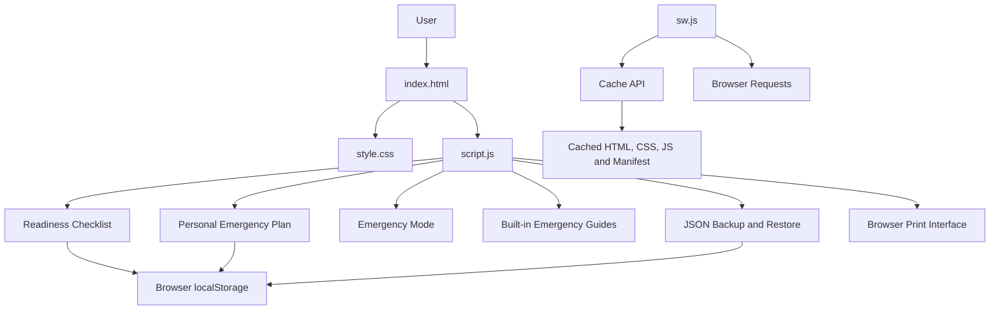

# NIRANTAR - Technical Design Document

## 1. Overview

NIRANTAR is a browser-based emergency preparedness application implemented with HTML, CSS, and JavaScript.

Its main design goal is to provide a single interface for preparedness tasks, saved personal emergency information, built-in safety guides, and backup and restore operations.

The current implementation does not use a backend database or external API.

## 2. System Architecture

### Components

**`index.html`**

Defines the interface, forms, checklist containers, navigation, emergency information areas, and buttons.

**`style.css`**

Provides visual styling and responsive layouts for different screen sizes.

**`script.js`**

Contains checklist rendering and progress calculations, local storage operations, personal plan handling, Emergency Mode, searchable guide data, JSON backup and restore, and print functionality.

**`sw.js`**

Registers the application shell cache, manages cache activation and cleanup, and handles eligible same-origin GET requests to support offline access.

**`manifest.json`**

Contains the web app manifest configuration used by the project.

## 3. Data Flow

### 3.1 Readiness Checklist

1. The application reads checklist data from `localStorage`.
2. If no saved checklist exists, it initializes the six default tasks as incomplete.
3. When the user changes a checkbox, JavaScript updates the task state.
4. The updated checklist is saved under `nirantar-checklist-v1`.
5. Progress statistics are recalculated and rendered.

### 3.2 Personal Emergency Plan

1. The application reads `nirantar-personal-plan-v1`.
2. Saved fields are loaded into the plan form when available.
3. On form submission, JavaScript collects the contact details, selected supplies, notes, and update timestamp.
4. The plan is serialized as JSON and stored in local storage.
5. Emergency Mode reads the saved plan to show the available information.

### 3.3 Backup Export

1. The application reads and validates the stored checklist.
2. It reads any saved personal plan.
3. It creates a JSON object containing the app identifier, schema version, export timestamp, checklist, and personal plan.
4. The browser downloads the file as `nirantar-backup.json`.

### 3.4 Backup Restore

1. The user selects a JSON backup file.
2. The application checks the file size and parses the JSON.
3. It checks the NIRANTAR identifier, supported schema version, and checklist structure.
4. The application asks the user to confirm replacing checklist progress.
5. Validated data is saved, and the page reloads.

**Implementation note:** In the current restore sequence, the checklist is written before the version 2 personal plan is validated. An invalid personal plan may therefore cause a partial restore. Validate the entire backup before writing either storage key if atomic restoration is required.

### 3.5 Offline Request Handling

1. The browser registers `sw.js` after page load.
2. The service worker caches the required application files.
3. When the application is revisited offline, cached resources can be served where available.
4. Built-in emergency guide content remains available through the cached JavaScript application.

Offline use depends on successful initial caching and supported browser service worker behavior.

## 4. Storage Design

| Key | Data |
|---|---|
| `nirantar-checklist-v1` | Array of checklist items, each with an `id` and Boolean `completed` property |
| `nirantar-personal-plan-v1` | Personal plan object |

### Checklist IDs

The expected checklist IDs are:

- `water`
- `first-aid`
- `contacts`
- `documents`
- `power`
- `plan`

### Personal Plan Fields

| Field | Type |
|---|---|
| `contactName` | String |
| `relationship` | String |
| `phone` | String |
| `supplies` | Array of strings |
| `notes` | String |
| `updatedAt` | Timestamp string |

Accepted supply identifiers are `water`, `first-aid`, `flashlight`, `power-bank`, `documents`, and `medicines`.

## 5. Backup Schema

### Version 1

Contains the NIRANTAR app identifier, schema version, export timestamp, and checklist data. It does not contain a personal plan.

### Version 2

Contains the same fields and adds `personalPlan`, which is either an object with the supported plan fields or `null`.

The application limits imported backup files to 1 MiB and validates the checklist IDs, duplicate entries, and completion value types.

## 6. Security and Privacy Considerations

- Personal plan data is stored in browser local storage.
- There is no cloud synchronization in the current implementation.
- Backup files may contain personal contact details and should be kept private.
- Public sample data must use fictional details.
- Clearing browser storage can remove saved information.
- This application does not automatically contact emergency services or send alerts.

## 7. Current Scope

The design describes the existing client-side implementation. It does not include server-side storage, user accounts, automatic emergency notifications, location tracking, or external API integration.
